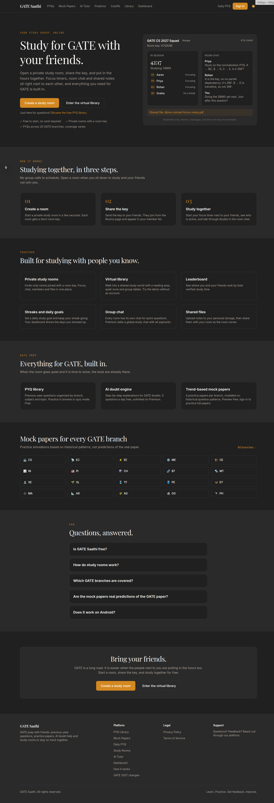
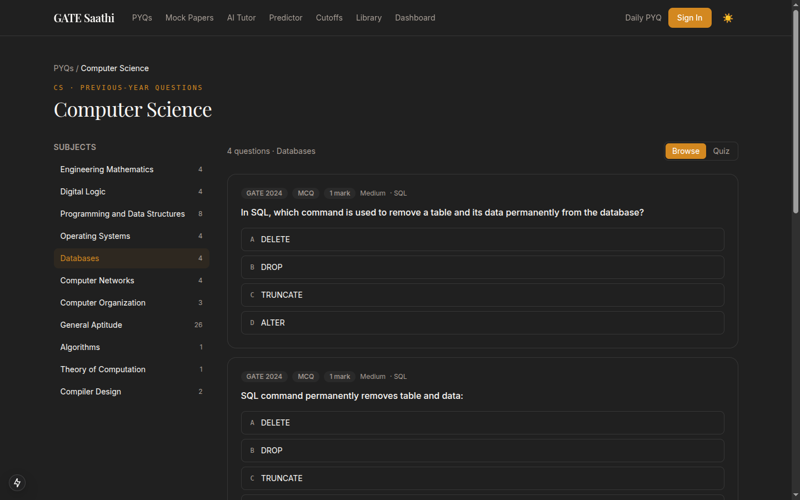
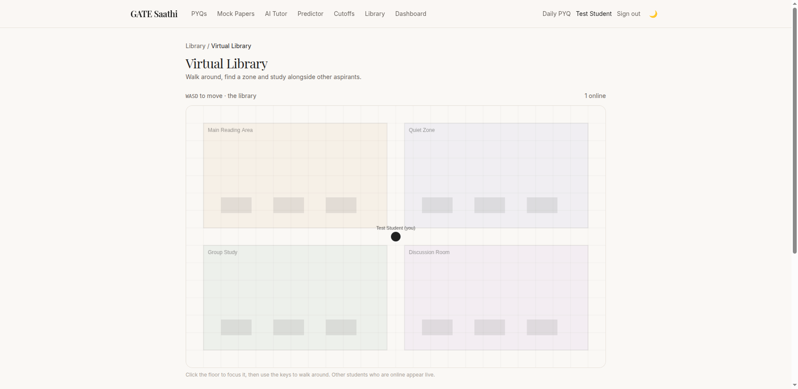
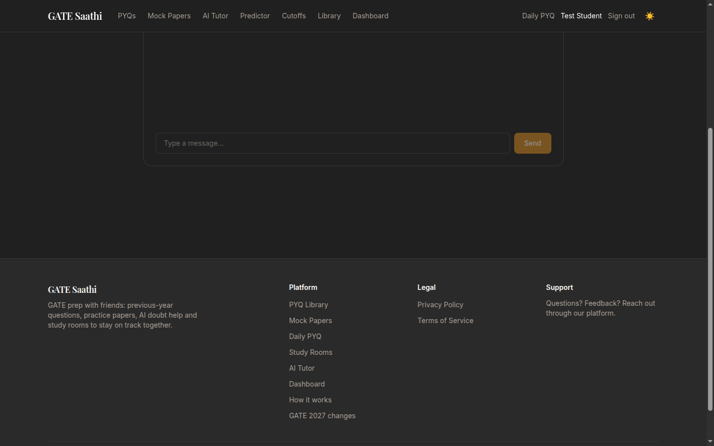

<div align="center">

# 🎓 GATE Saathi

**Prepare for GATE together — not alone.**

A full-stack study platform with shared focus rooms, a virtual library, a real
question bank, trend-based mock papers, an AI doubt engine, and a rank predictor.


</div>

---

## Table of contents

- [Overview](#overview)
- [Screenshots](#screenshots)
- [Features](#features)
- [Tech stack](#tech-stack)
- [Quick start](#quick-start)
- [Configuration](#configuration)
- [Using Postgres / Supabase](#using-postgres--supabase)
- [Scripts](#scripts)
- [Testing](#testing)
- [Project structure](#project-structure)
- [Architecture](#architecture)
- [Reference-data collection](#reference-data-collection)
- [Deployment](#deployment)
- [Roadmap & status](#roadmap--status)
- [Documentation](#documentation)
- [License](#license)

## Overview

GATE Saathi is a GATE (Graduate Aptitude Test in Engineering) exam-prep platform
built around **studying with friends**: private study rooms with a focus timer,
chat and shared files; a top-down virtual library "world"; previous-year
questions (PYQs) with browse and quiz modes; trend-based mock papers; an AI doubt
engine; a rank predictor; historical cutoffs; and streaks, leaderboards and a
topic heatmap to keep momentum.

It is a single Next.js 15 application serving both the UI and a typed REST API,
backed by Prisma. It runs **out of the box with zero external services** —
SQLite, dev login, and a graceful "coming soon" state for the AI engine — and
scales up to Postgres/Supabase, Google OAuth and the Anthropic API by setting a
few environment variables.

**Built on real data.** Every question, paper, cutoff and resource is collected
from the authorized reference site. Where data could not be collected, the app
says so honestly rather than fabricating a value.

## Screenshots

| Home | PYQ quiz |
|---|---|
|  |  |

| Virtual library world | Study-room chat |
|---|---|
|  |  |

## Features

- 📚 **PYQ library** — 20 GATE branches, 213 subjects, 559 real questions; browse and timed quiz modes with recorded attempts and honest grading.
- 📝 **Mock papers** — trend-based predicted papers with real metadata (totals, difficulty split, subject breakdown).
- 🤖 **AI doubt engine** — ask a doubt, get an answer from the Anthropic API; free-tier daily limit; degrades to "coming soon" when no key is set (never a fake answer).
- 📈 **Rank predictor** — estimates rank from a GATE score using historical qualifying statistics, transparently labelled an estimate.
- 📊 **Cutoffs** — historical qualifying cutoffs per branch, year and category.
- 👥 **Study rooms** — create/join by key, shared focus timer, live chat and member presence (HTTP polling), shared files.
- 🏛️ **Virtual library world** — a 2D canvas with WASD movement, zones and live presence.
- 🔥 **Dashboard, streaks, leaderboard, heatmap** — activity tracking, daily goals, study-time leaderboard, and a premium topic heatmap.
- 🔐 **Auth** — Google sign-in (Auth.js) with a local dev-login fallback.
- 💎 **Premium entitlement** — gating is modeled end to end (`User.plan` / `isPremium`).

Full feature-by-feature status and reference parity: [FEATURES.md](docs/FEATURES.md).

## Tech stack

| Area | Technology |
|---|---|
| Framework | Next.js 15 (App Router), React 19, TypeScript 5.7 |
| Styling | Tailwind CSS v4, design tokens extracted from the reference |
| Database | Prisma 6 ORM over SQLite (Postgres/Supabase-compatible) |
| Auth | Auth.js (NextAuth 4) — Google + dev credentials, JWT sessions |
| AI | Anthropic Messages API (`claude-haiku-5-5`) |
| Realtime | HTTP polling (matches the reference) |
| Validation | zod |
| Testing | Vitest (unit) + Playwright (e2e) |
| CI/CD | GitHub Actions |

## Quick start

**Prerequisites:** Node.js 20+ and npm. No external services needed for local dev.

```bash
# 1. Install dependencies
npm install

# 2. Create your env file (defaults run as-is)
cp .env.example .env.local

# 3. Create and seed the database
npx prisma migrate dev          # creates the local SQLite database
npm run db:seed                 # seeds branches, PYQs, papers, cutoffs from data/

# 4. Start the dev server
npm run dev                     # http://localhost:3000
```

That's it. Sign in with the dev-login option, browse the PYQ library, create a
study room, and try the predictor — all without any external keys.

> **Note:** `DATABASE_URL` must also be present in `.env` (not only `.env.local`),
> because the Prisma CLI reads `.env`. The copied `.env.example` covers this.

## Configuration

All configuration is via environment variables. The app runs with none of them
set; add them to `.env.local` to enable the corresponding feature.

| Variable | Required | Purpose |
|---|---|---|
| `DATABASE_URL` | yes (defaulted) | Prisma connection string. Defaults to local SQLite. |
| `NEXTAUTH_SECRET` | prod | Session/JWT signing secret. |
| `NEXTAUTH_URL` | prod | Canonical app URL. |
| `ENABLE_DEV_LOGIN` | dev only | Enables the local dev-login fallback. Disable in production. |
| `GOOGLE_CLIENT_ID` / `GOOGLE_CLIENT_SECRET` | for Google sign-in | Real Google OAuth. |
| `ANTHROPIC_API_KEY` | for AI doubts | Enables the AI doubt engine; otherwise it shows "coming soon". |

See [`.env.example`](.env.example) for the full list and example values.

## Using Postgres / Supabase

SQLite is the local default. To use Postgres (for example Supabase, matching the
reference's backend):

1. In `prisma/schema.prisma`, set `datasource db { provider = "postgresql" }`.
2. Set `DATABASE_URL` to your Postgres connection string.
3. Run `npx prisma migrate deploy` (or `migrate dev` locally), then `npm run db:seed`.

No application code changes are needed — all data access goes through Prisma.

## Scripts

| Command | Purpose |
|---|---|
| `npm run dev` | Start the dev server |
| `npm run build` / `npm start` | Production build / serve |
| `npm run lint` | ESLint |
| `npm run typecheck` | `tsc --noEmit` |
| `npm test` | Unit tests (Vitest) |
| `npm run test:e2e` | End-to-end tests (Playwright) |
| `npm run db:migrate` | `prisma migrate dev` |
| `npm run db:seed` | Seed the database from `data/` |
| `npm run db:reset` | Reset and re-seed the database |

## Testing

```bash
npm run typecheck     # type safety
npm run lint          # linting
npm test              # unit tests (predictor, stats, utils)
npm run build         # production build
npm run test:e2e      # Playwright (specs in progress)
```

The predictor and stats logic are unit-tested. Typecheck, lint, unit tests and
the production build are all green on `main`, and run in CI on every push and PR.

## Project structure

```
src/app          Routes + REST API route handlers (see docs/page-inventory.md)
src/app/api      One folder per resource (pyq, rooms, study, ai, library, …)
src/components   home/ · layout/ · pyq/ · ui/ (token-driven primitives)
src/lib          db, auth, session, anthropic, predictor, stats, branches, rooms
src/styles       globals.css — design tokens (colors, fonts)
prisma           schema.prisma + migrations
scripts          seed.ts + owner-run data collectors
data             collected reference data (JSON, CSV)
storage          library/ (committed, authorized) · user/ (gitignored uploads)
docs             audit, inventories, known differences, match report, screenshots
.github          CI/deploy workflows, PR + issue templates
```

## Architecture

A single Next.js app renders the UI (Server + Client Components) and serves a
typed REST API that talks to the database through Prisma. Realtime surfaces
(room chat, library presence) use HTTP polling, matching the reference.
Presence is held in process memory, so a consistent multiplayer deployment uses
a single long-running Node instance.

Full details — rendering model, data model, API surface, security invariants and
the data pipeline — are in [ARCHITECTURE.md](docs/ARCHITECTURE.md).

## Reference-data collection

Two datasets can only be collected from the live site with the owner's own
authenticated session, so they are provided as browser-console scripts run
manually (not automatically):

- `scripts/collect-answers.console.js` — derives verified MCQ answer keys via the
  grading endpoint → `data/pyq/answers.json`.
- `scripts/collect-resources.console.js` — downloads the published library PDFs →
  `storage/library/` + `data/misc/library-manifest.json`.

Instructions are in each file's header. The app works fully without them;
questions without a verified key are flagged accordingly.

> **Current note:** the reference's grading endpoint is returning HTTP 500, so
> answer-key collection is temporarily blocked upstream. See [STATUS.md](docs/STATUS.md).

## Deployment

- **Host:** prefer a single long-running Node host (VPS, Railway, Fly) because
  presence is in-process; or externalize presence to a shared store (for example
  Redis) first — tracked in [docs/next_steps.md](docs/next_steps.md).
- **Database:** switch Prisma to `postgresql`, set `DATABASE_URL`, run
  `prisma migrate deploy`, then seed.
- **Secrets:** set `NEXTAUTH_SECRET`, `NEXTAUTH_URL`, Google OAuth credentials and
  `ANTHROPIC_API_KEY`; disable `ENABLE_DEV_LOGIN`.
- **CI/CD:** GitHub Actions run lint/typecheck/test/build (`.github/workflows/ci.yml`)
  and a build+artifact deploy step (`deploy.yml`).

## Roadmap & status

Current state is tracked in [STATUS.md](docs/STATUS.md); the actionable backlog in
[docs/next_steps.md](docs/next_steps.md) and as GitHub issues. Highlights:

- Subscription / billing (Razorpay or Stripe) — entitlement exists, money half pending.
- Interactive full mock-paper runner.
- Mistake / bookmark bank from attempt data.
- Room file-sharing UI, storage quotas.
- Playwright e2e specs; move presence to a shared store for horizontal scaling.

## Documentation

| Doc | What's in it |
|---|---|
| [SPEC.md](docs/SPEC.md) | Product definition and behavior contract |
| [ARCHITECTURE.md](docs/ARCHITECTURE.md) | Technical design, data model, API surface |
| [FEATURES.md](docs/FEATURES.md) | Feature matrix with status and reference parity |
| [STATUS.md](docs/STATUS.md) | Current-state snapshot |
| [CONTRIBUTING.md](docs/CONTRIBUTING.md) | Dev setup, git flow, conventions |
| [CLAUDE.md](CLAUDE.md) | Conventions and gotchas for AI/code agents |
| [SECURITY.md](docs/SECURITY.md) | Vulnerability reporting and security invariants |
| [docs/](docs/) | Audit, page/resource inventories, known differences, match report |

## License

Proprietary — © 2026 Manish Tiwari. All rights reserved. See [LICENSE](LICENSE).
This is a private, authorized reconstruction; reconstructed content remains the
property of its respective owners.
